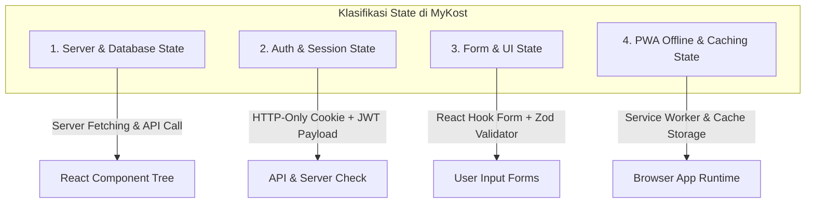

# 🏗️ Arsitektur Sistem MyKost

Dokumen ini menjelaskan arsitektur teknis, topologi infrastruktur, pola manajemen state (*state management*), serta pembagian komponen pada aplikasi **MyKost**.

---

## 1. Topologi Sistem & Infrastruktur

MyKost dirancang dengan arsitektur *modern serverless full-stack* berbasis **Next.js (App Router)** yang terintegrasi dengan ekosistem cloud terdistribusi:

```mermaid
flowchart TD
    subgraph Client ["Client Device (Mobile / Desktop)"]
        Browser["Web Browser (PWA Supported)"]
        SW["Service Worker (sw.js) & Manifest"]
    end

    subgraph Hosting ["Vercel Edge & Serverless Platform"]
        NextFront["Next.js App Router (UI / Server Components)"]
        APIHandlers["Next.js Route Handlers (/api/*)"]
        VercelCron["Vercel Cron Service (Scheduled Jobs)"]
    end

    subgraph Database ["Supabase Managed Cloud"]
        PgBouncer["PgBouncer Connection Pooler (:6543)"]
        Postgres["PostgreSQL Database Engine (:5432)"]
    end

    subgraph Storage ["Cloudflare R2 Object Storage"]
        R2Bucket["S3-Compatible Bucket (mykost)"]
        PublicCDN["Cloudflare CDN / Public Domain"]
    end

    subgraph Messaging ["Fonnte WhatsApp Gateway"]
        FonnteAPI["api.fonnte.com (REST API)"]
        WABroadcast["WhatsApp Network (Notifikasi Penghuni)"]
    end

    Browser <--> |HTTPS / WSS| NextFront
    Browser <--> |Local Cache & Assets| SW
    NextFront --> APIHandlers
    VercelCron --> |HTTP GET + Bearer Secret| APIHandlers

    APIHandlers --> |Prisma ORM (Pooled)| PgBouncer
    PgBouncer --> Postgres
    APIHandlers --> |@aws-sdk/client-s3| R2Bucket
    R2Bucket --> PublicCDN
    Browser -.-> |Fetch Image via Public CDN| PublicCDN

    APIHandlers --> |HTTPS POST API Token| FonnteAPI
    FonnteAPI --> WABroadcast
```

### Komponen Infrastruktur:
1. **Frontend & Application Server (Vercel)**:
   - Hosting hybrid: Server-Side Rendering (SSR), Server Components (RSC), dan Serverless Route Handlers.
   - PWA caching untuk performa cepat pada perangkat seluler.
2. **Database Engine (Supabase PostgreSQL)**:
   - Manajemen relasi terstruktur via Prisma ORM v6.
   - Dual connection: `DATABASE_URL` menggunakan PgBouncer (`6543`) untuk serverless handler, dan `DIRECT_URL` (`5432`) untuk migrasi skema.
3. **Media Storage (Cloudflare R2)**:
   - Penyimpanan berkas foto KTP, foto kamar, bukti pembayaran transfer, dan lampiran komplain.
   - Menggunakan `@aws-sdk/client-s3` dengan zero-egress fee.
4. **WhatsApp Notification Gateway (Fonnte)**:
   - Pengiriman otomatis reminder tagihan sewa, instruksi onboarding, konfirmasi pembayaran, dan notifikasi keluhan.

---

## 2. Lapisan Arsitektur Perangkat Lunak (*Layered Architecture*)

```mermaid
flowchart LR
    subgraph L1 ["1. Presentation Layer"]
        RSC["React Server Components"]
        RCC["React Client Components"]
        UI["Tailwind CSS v4 + Lucide"]
    end

    subgraph L2 ["2. Security & Controller Layer"]
        AuthGuards["RBAC Guards (requireAuthApi, requireRoleApi)"]
        Routes["API Route Handlers (/api/*)"]
    end

    subgraph L3 ["3. Domain & Service Layer"]
        TagihanSvc["Tagihan & Billing Engine"]
        NotifSvc["In-App & WA Notification Engine"]
        StorageSvc["R2 Media Upload Service"]
        AuditSvc["Activity Logger Service"]
    end

    subgraph L4 ["4. Data Access Layer"]
        PrismaORM["Prisma Client"]
        PostgresDB[(PostgreSQL)]
    end

    L1 --> L2
    L2 --> L3
    L3 --> L4
```



### Penjelasan Setiap Lapisan:
- **Presentation Layer (`src/app/`)**:
  - Halaman antarmuka dipisahkan berdasarkan role: group route `(dashboard)/owner/*` dan `(dashboard)/penghuni/*`.
  - Mengedepankan *mobile-first UX* dengan layout adaptif: sidebar desktop untuk pengelola dan bottom-navigation bar untuk mobile PWA.
- **Security & Controller Layer (`src/lib/rbac.ts`, `src/lib/auth.ts`)**:
  - Validasi token JWT yang disimpan di HTTP-Only Cookie.
  - Penegakan otorisasi peran (*Role-Based Access Control*): `OWNER`, `ADMIN`, dan `PENGHUNI`.
  - Fail-closed security pada webhook & cron routes.
- **Domain & Service Layer (`src/lib/*`)**:
  - `tagihan.ts`: Generator invoice tagihan bulanan otomatis dan anti-duplikat.
  - `notifikasi.ts`: Dispatcher notifikasi multi-target ke user dan admin.
  - `fonnte.ts`: Client integrasi WhatsApp gateway Fonnte.
  - `r2.ts`: Client upload S3 Cloudflare R2 dengan validasi MIME & ukuran.
  - `log.ts`: Pencatatan jejak audit audit-trail pengelola.
- **Data Access Layer (`prisma/schema.prisma`)**:
  - Akses data terisolasi menggunakan Prisma ORM dengan *type-safety* penuh di seluruh aplikasi.

---

## 3. Strategi Manajemen State (*State Management*)

Aplikasi MyKost tidak memerlukan Redux atau library state global yang berat karena membagi state ke dalam 4 domain yang jelas:



### 3.1. Server & Database State
- **Pendekatan**: *Server-First Hydration*.
- Data halaman utama diambil langsung oleh Server Components saat request tiba, meminimalisir *layout shift* dan meniadakan *waterfall fetching*.
- Sinkronisasi data di Client Component dilakukan melalui `fetch` ke endpoint REST internal, diikuti dengan pembaruan state lokal atau trigger `router.refresh()`.

### 3.2. Session & Authentication State
- Token otentikasi disimpan di **HTTP-Only Cookie** bernama `auth_token` dengan flag:
  - `HttpOnly: true` (mencegah pencurian token via serangan XSS).
  - `SameSite: Lax` (perlindungan dasar CSRF).
  - `Secure: true` pada environment produksi.
- Token berisi payload:
  ```json
  {
    "id": "cuid_user_id",
    "email": "user@mykost.com",
    "role": "OWNER | ADMIN | PENGHUNI",
    "exp": 1799999999
  }
  ```
- Pembacaan session dilakukan di server side via helper `requireAuthApi()` atau `requireRoleApi()` sehingga client tidak memanipulasi role pengguna.

### 3.3. Form State & Input Validation
- Menggunakan kombinasi **React Hook Form** dan **Zod** untuk form kompleks (misal: onboarding penghuni, penggantian password, formulir komplain).
- Mengurangi re-render DOM dan memberikan feedback validasi instan pada level komponen sebelum data dikirimkan ke server.

### 3.4. PWA & Offline State
- Registrasi service worker pada [public/sw.js](file:///c:/Users/Zee/Documents/myproject/KostManagement/public/sw.js) mengelola *Network-First* dan *Cache-First* untuk asset statis (icons, CSS, manifest).
- Komponen [OfflineBanner.tsx](file:///c:/Users/Zee/Documents/myproject/KostManagement/src/components/pwa/OfflineBanner.tsx) memonitor status `navigator.onLine` dan menampilkan indikator visual jika penghuni kehilangan koneksi internet.

---

## 4. Struktur Direktori Proyek

```
KostManagement/
├── docs/                               # 📚 Dokumentasi Teknis Lengkap
│   ├── ARCHITECTURE.md                 # Arsitektur & State Management
│   ├── USE_CASE_AND_FLOWS.md           # Use Case, Activity & Flowchart
│   ├── DATABASE_AND_STATE.md           # ERD & State Machine Entity
│   ├── API_AND_SECURITY.md             # API Reference & Security Architecture
│   └── DEPLOYMENT_AND_OPERATIONS.md    # Panduan Deploy & Operasional
├── prisma/                             # 🗄️ Database ORM
│   ├── schema.prisma                   # Skema Model, Enum, & Relasi Prisma
│   └── seed.ts                         # Data Seeding Awal (Dev / Staging)
├── public/                             # 🌐 Asset Statis & PWA
│   ├── icons/                          # Ikon PWA (192px, 512px)
│   ├── manifest.json                   # Web App Manifest PWA
│   ├── sw.js                           # PWA Service Worker
│   └── uploads/                        # Fallback Local Storage (Dev)
├── src/
│   ├── app/                            # 🚀 Next.js App Router
│   │   ├── (auth)/login/               # Halaman Login
│   │   ├── (dashboard)/
│   │   │   ├── owner/                  # Halaman Panel Owner & Admin
│   │   │   │   ├── dashboard/          # Statistik & KPI
│   │   │   │   ├── kamar/              # Manajemen Kamar Kost
│   │   │   │   ├── penghuni/           # Onboarding & Data Penghuni
│   │   │   │   ├── tagihan/            # Invoice & Tagihan Sewa
│   │   │   │   ├── verifikasi/         # Review Bukti Transfer
│   │   │   │   ├── pengaduan/          # Manajemen Komplain Masuk
│   │   │   │   ├── laporan/            # Laporan Keuangan & Excel
│   │   │   │   ├── log/                # Jejak Audit Aktivitas
│   │   │   │   ├── pengaturan/         # Tarif Denda & Template WA
│   │   │   │   └── users/              # Manajemen Akun Pengelola
│   │   │   └── penghuni/               # Halaman PWA Penghuni
│   │   │       ├── beranda/            # Dashboard Penghuni & Info Kamar
│   │   │       ├── tagihan/            # Riwayat & Bayar Tagihan
│   │   │       ├── komplain/           # Buat & Pantau Komplain
│   │   │       └── profil/             # Data Diri, Kontrak, & Password
│   │   └── api/                        # ⚡ Backend REST Route Handlers
│   │       ├── auth/                   # Login, Register, Logout
│   │       ├── kamar/                  # CRUD & Filter Kamar
│   │       ├── penghuni/               # Master Data Penghuni
│   │       ├── kontrak/                # Onboarding & Status Kontrak
│   │       ├── tagihan/                # Invoice Bulanan & Notif
│   │       ├── pembayaran/             # Upload & Approval Pembayaran
│   │       ├── pengaduan/              # Tiket Komplain Penghuni
│   │       ├── cron/tagihan/           # Cron Job Tagihan & WA Reminder
│   │       └── users/                  # Pengelolaan User & Password
│   ├── components/                     # 🧩 Reusable React Components
│   │   ├── layouts/                    # Header, OwnerSidebar, BottomNav
│   │   ├── pwa/                        # OfflineBanner, Service Worker Hook
│   │   └── ExportExcelButton.tsx       # Export Laporan Excel (ExcelJS)
│   └── lib/                            # 🛠️ Shared Libraries & Helpers
│       ├── auth.ts                     # JWT Sign & Verify (jose)
│       ├── fonnte.ts                   # Gateway WhatsApp Fonnte
│       ├── log.ts                      # Pencatatan Jejak Audit
│       ├── notifikasi.ts               # In-App Notification Dispatcher
│       ├── prisma.ts                   # Prisma Singleton Client
│       ├── r2.ts                       # Cloudflare R2 Upload & Validation
│       ├── rbac.ts                     # Role-Based Access Control Guards
│       ├── tagihan.ts                  # Engine Pembuat Tagihan Bulanan
│       └── utils.ts                    # Format Rupiah, Tanggal Indonesia
└── package.json                        # Dependencies & Script Konfigurasi
```
