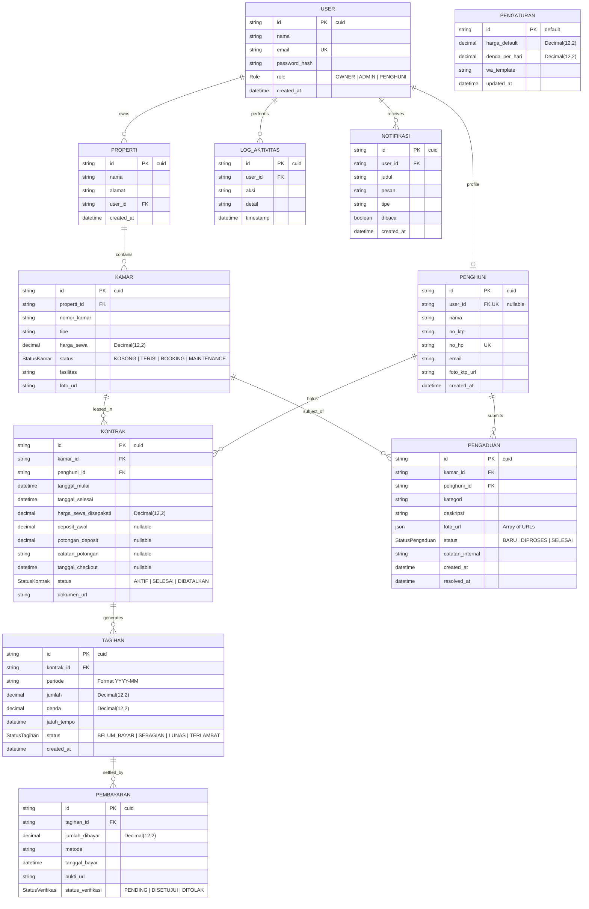
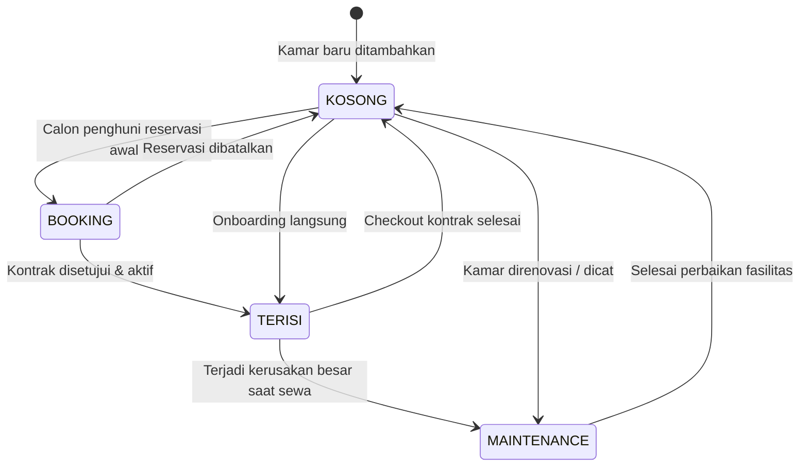
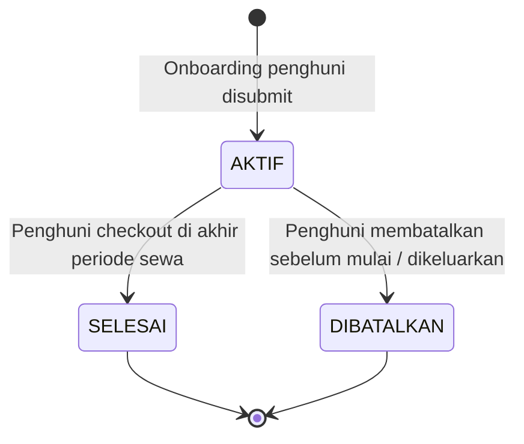
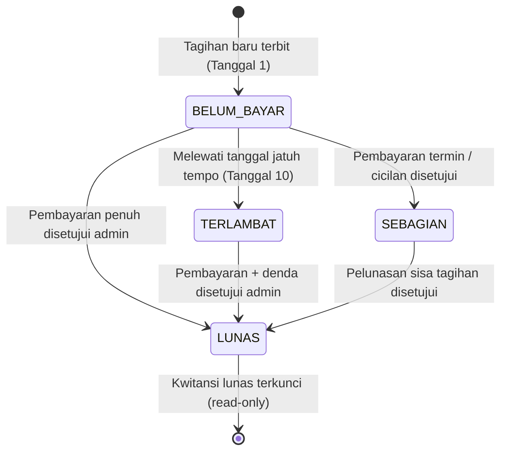
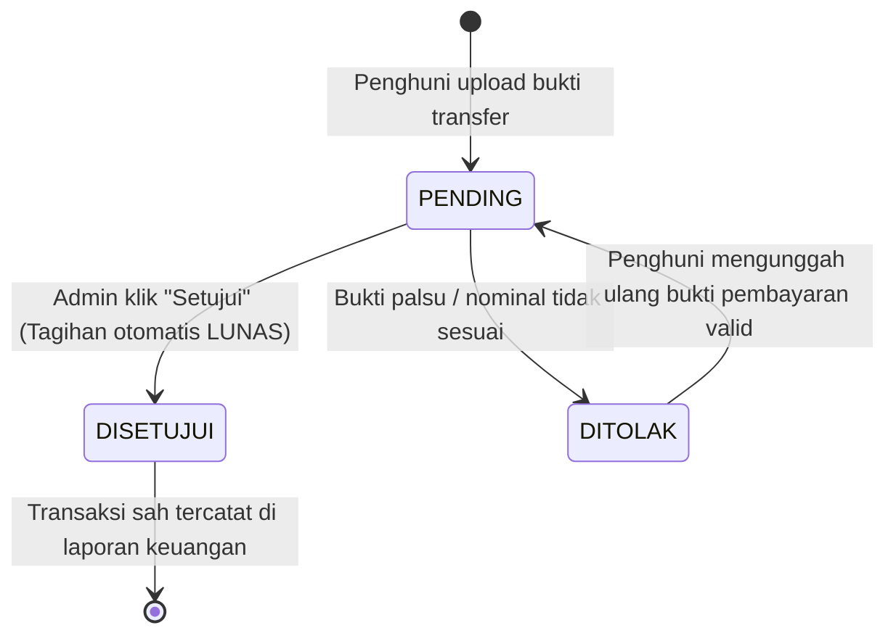
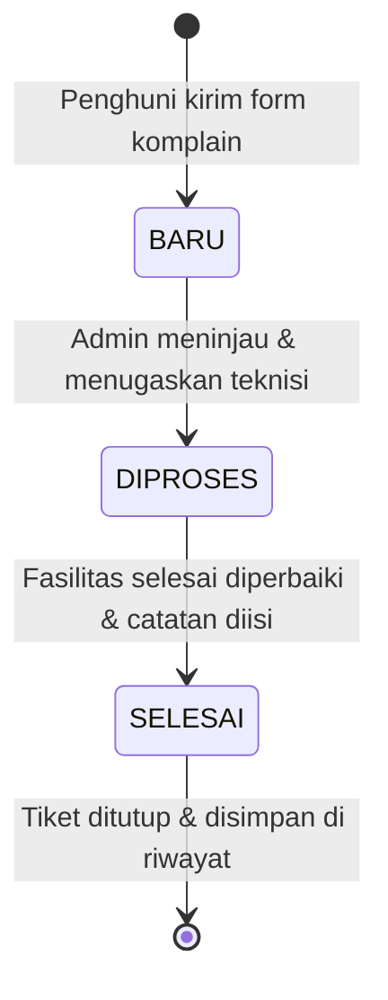

# 🗄️ Database, ERD, & State Machine Entity

Dokumen ini menjelaskan struktur basis data relasional, kamus data (*data dictionary*), diagram hubungan antar entitas (*Entity-Relationship Diagram* / ERD), serta siklus status (*Finite State Machines*) untuk setiap entitas utama pada sistem **MyKost**.

---

## 1. Entity-Relationship Diagram (ERD)

---

## 2. Kamus Data & Spesifikasi Model (*Data Dictionary*)

### 2.1. Model `User`
Menyimpan akun autentikasi untuk login ke sistem.
- `id` (String, PK, CUID): ID unik pengguna.
- `nama` (String): Nama lengkap pengguna.
- `email` (String, Unique): Alamat email untuk kredensial login.
- `password_hash` (String): Hash sandi terenkripsi menggunakan bcrypt (salt round: 10).
- `role` (Enum `Role`): Hak akses (`OWNER`, `ADMIN`, `PENGHUNI`).
- `created_at` (DateTime): Waktu pendaftaran akun.

### 2.2. Model `Kamar`
Menyimpan data fisik kamar kost.
- `id` (String, PK, CUID): ID unit kamar.
- `properti_id` (String, FK): Relasi ke Properti pemilik kamar.
- `nomor_kamar` (String): Nomor/label kamar (contoh: "101", "204").
- `tipe` (String): Kategori kamar (contoh: "Deluxe AC", "Standard Fan").
- `harga_sewa` (Decimal(12,2)): Tarif sewa per bulan.
- `status` (Enum `StatusKamar`): Kondisi kamar (`KOSONG`, `TERISI`, `BOOKING`, `MAINTENANCE`).
- `fasilitas` (String): Daftar fasilitas kamar (kamar mandi dalam, WiFi, dll).
- `foto_url` (String, Nullable): URL foto kamar di Cloudflare R2.

### 2.3. Model `Kontrak`
Mewakili perjanjian sewa kamar antara pengelola dan penghuni.
- `id` (String, PK, CUID): ID kontrak perjanjian.
- `kamar_id` (String, FK): Kamar yang disewa.
- `penghuni_id` (String, FK): Data penyewa kamar.
- `tanggal_mulai` & `tanggal_selesai` (DateTime): Periode masa sewa.
- `harga_sewa_disepakati` (Decimal(12,2)): Harga kesepakatan per bulan.
- `deposit_awal` (Decimal(12,2), Nullable): Uang jaminan saat awal masuk.
- `potongan_deposit` (Decimal(12,2), Nullable): Potongan saat checkout (jika ada kerusakan/tunggakan).
- `catatan_potongan` (String, Nullable): Alasan potongan deposit.
- `tanggal_checkout` (DateTime, Nullable): Tanggal riil penghuni keluar.
- `status` (Enum `StatusKontrak`): `AKTIF`, `SELESAI`, `DIBATALKAN`.

### 2.4. Model `Tagihan`
Invoice kewajiban pembayaran sewa per bulan.
- `id` (String, PK, CUID): ID tagihan.
- `kontrak_id` (String, FK): Kontrak sewa rujukan.
- `periode` (String): Format periode `YYYY-MM` (contoh: "2026-10").
- `jumlah` (Decimal(12,2)): Nominal pokok tagihan sewa.
- `denda` (Decimal(12,2)): Denda keterlambatan (dinamis dari pengaturan).
- `jatuh_tempo` (DateTime): Batas akhir pembayaran (default tanggal 10 tiap bulan).
- `status` (Enum `StatusTagihan`): `BELUM_BAYAR`, `SEBAGIAN`, `LUNAS`, `TERLAMBAT`.

### 2.5. Model `Pembayaran`
Pencatatan transaksi pembayaran yang diunggah oleh penghuni.
- `id` (String, PK, CUID): ID pembayaran.
- `tagihan_id` (String, FK): Tagihan yang dibayar.
- `jumlah_dibayar` (Decimal(12,2)): Jumlah uang yang ditransfer.
- `metode` (String): Metode bayar (contoh: "Transfer Bank", "BCA", "QRIS").
- `tanggal_bayar` (DateTime): Tanggal transfer dilakukan.
- `bukti_url` (String): URL berkas bukti struk transfer di Cloudflare R2.
- `status_verifikasi` (Enum `StatusVerifikasi`): `PENDING`, `DISETUJUI`, `DITOLAK`.

### 2.6. Model `Pengaduan`
Tiket laporan keluhan atau perbaikan fasilitas.
- `id` (String, PK, CUID): ID pengaduan.
- `kamar_id` & `penghuni_id` (String, FK): Lokasi dan pelapor keluhan.
- `kategori` (String): Kategori (misal: "Kelistrikan", "Pipa/Air", "AC").
- `deskripsi` (String): Penjelasan detail kerusakan.
- `foto_url` (Json, Nullable): Array URL foto bukti kerusakan.
- `status` (Enum `StatusPengaduan`): `BARU`, `DIPROSES`, `SELESAI`.
- `catatan_internal` (String, Nullable): Catatan pengelola / teknisi perbaikan.
- `resolved_at` (DateTime, Nullable): Timestamp saat keluhan tuntas.

---

## 3. Siklus Status Entitas (*Finite State Machines*)

### 3.1. Siklus Status Kamar (`StatusKamar`)

### 3.2. Siklus Status Kontrak (`StatusKontrak`)

### 3.3. Siklus Status Tagihan (`StatusTagihan`)

### 3.4. Siklus Status Pembayaran (`StatusVerifikasi`)

### 3.5. Siklus Status Pengaduan (`StatusPengaduan`)

---

## 4. Integritas Data & Aturan Transaksi (*Integrity Rules*)

1. **Pencegahan Tagihan Ganda (*Anti-Duplicate Billing*)**:
   - Generator tagihan (`generateMonthlyBills()`) selalu memeriksa keberadaan record tagihan dengan kombinasi `{ kontrak_id, periode }` sebelum mengeksekusi `create`.
   - Menghindari tagihan ganda jika cron terpanggil berulang kali pada tanggal 1.
2. **Atomisitas Verifikasi Pembayaran (`Prisma Transaction`)**:
   - Pembaruan status verifikasi pembayaran menggunakan `prisma.$transaction(async (tx) => { ... })`.
   - Mengubah status `pembayaran.status_verifikasi = DISETUJUI` dan `tagihan.status = LUNAS` secara atomik dalam satu transaksi SQL. Jika salah satu gagal, seluruh operasi di-rollback.
3. **Presisi Finansial (*Decimal Precision*)**:
   - Seluruh kolom moneter (`harga_sewa`, `jumlah`, `denda`, `jumlah_dibayar`, `deposit_awal`) menggunakan tipe `Decimal(12, 2)` pada PostgreSQL untuk mencegah bug pembulatan angka (*floating-point rounding issue*).
