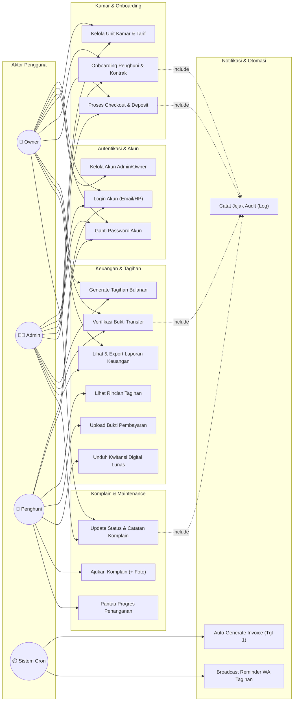
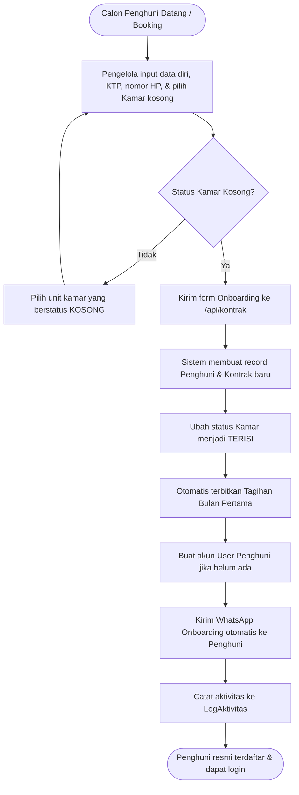
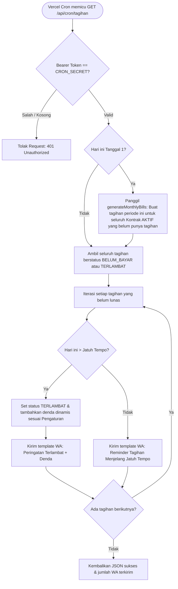
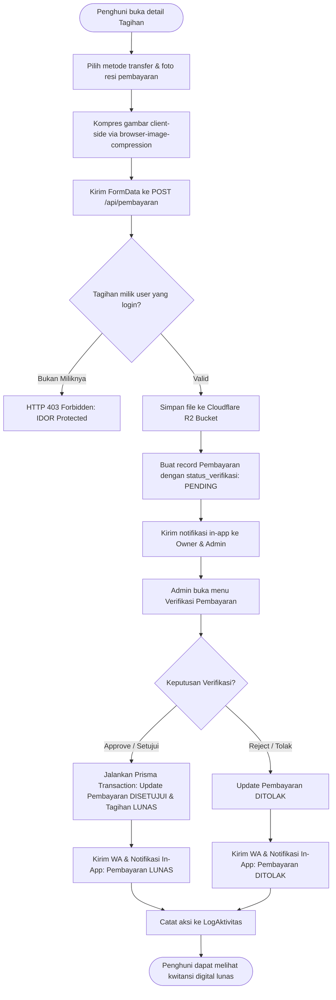
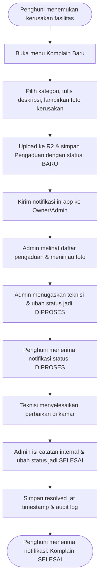
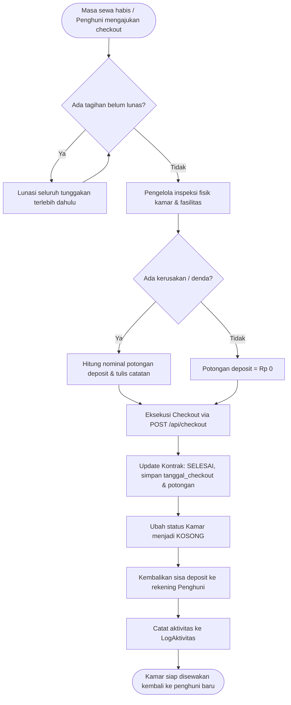
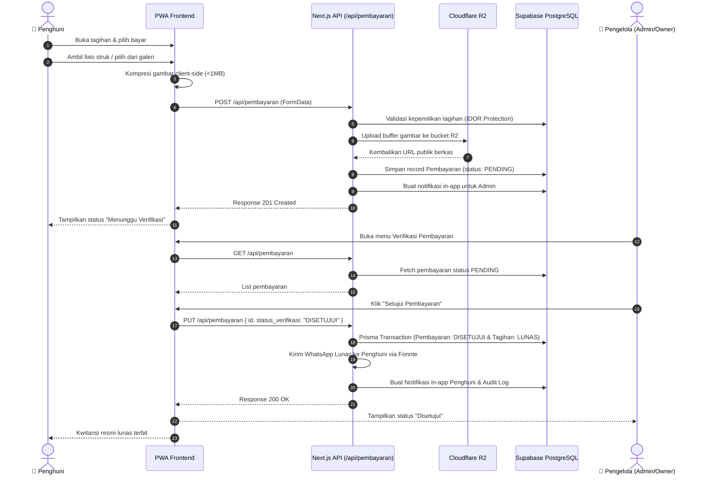

# 📋 Use Case, Alur Bisnis, & Activity Diagram

Dokumen ini memetakan seluruh aktor, *use case*, diagram alir bisnis (*flowchart*), serta diagram aktivitas (*activity diagram*) pada sistem **MyKost**.

---

## 1. Definisi Aktor & Matriks Hak Akses

Sistem MyKost melibatkan 4 aktor utama (3 aktor manusia dan 1 aktor sistem):

| Aktor | Deskripsi Peran | Hak Akses Utama |
| :--- | :--- | :--- |
| **Owner (Pemilik Kost)** | Pemilik properti kost dengan otoritas tertinggi operasional dan finansial. | Akses penuh dashboard, seluruh properti/kamar, verifikasi pembayaran, laporan laba rugi, penyesuaian tarif, dan manajemen akun pengelola (tambah/hapus Admin). |
| **Admin (Pengelola)** | Petugas operasional harian yang mengelola kamar, penghuni, dan keluhan. | Manajemen kamar, onboarding penghuni, input kontrak, verifikasi pembayaran, respon pengaduan, dan monitoring tagihan. Tidak bisa mengubah kepemilikan properti utama. |
| **Penghuni (Tenant)** | Penyewa kamar kost yang menggunakan aplikasi PWA di perangkat seluler. | Melihat info kamar & sisa masa sewa, melihat tagihan, mengunggah bukti pembayaran, mengajukan komplain maintenance (+ foto), dan mengunduh kwitansi lunas. |
| **Sistem / Cron Job** | Layanan otomasi terjadwal yang dipicu secara periodik oleh Vercel Cron. | Men-generate tagihan sewa bulanan otomatis pada tanggal 1 tiap bulan, mengalkulasi denda keterlambatan dinamis, dan mengirimkan reminder WhatsApp. |

---

## 2. Diagram Use Case (*Use Case Diagram*)

---

## 3. Alur Bisnis Utama (*Business Flows*)

### 3.1. Alur 1: Onboarding Penghuni & Pembuatan Kontrak (Alur 6.1)
Alur ketika ada penghuni baru yang mendaftar dan menyewa kamar kost.

---

### 3.2. Alur 2: Otomatisasi Tagihan Bulanan & Reminder WA (Cron Job)
Alur otomatisasi yang dijalankan setiap hari oleh scheduler Vercel Cron.

---

### 3.3. Alur 3: Siklus Pembayaran & Verifikasi Transfer (Alur 6.2)
Alur pengunggahan bukti transfer oleh penghuni hingga verifikasi oleh admin/owner.

---

### 3.4. Alur 4: Pengaduan Fasilitas / Maintenance & Resolusi (Alur 6.3)
Alur pelaporan kerusakan fasilitas kost hingga selesai ditangani.

---

### 3.5. Alur 5: Checkout Penghuni & Pengembalian Deposit
Alur ketika masa sewa penghuni berakhir dan keluar dari kost.

---

## 4. Diagram Aktivitas (*Activity Diagram*)

### Activity Diagram: Verifikasi Pembayaran oleh Pengelola

